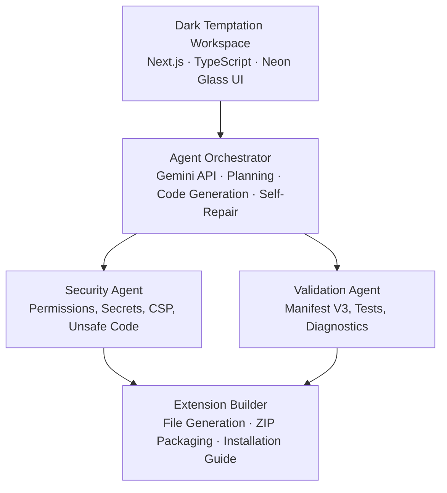

# ⚡ TEMPTATION AI // Autonomous Chrome Extension Laboratory

> **"Imagine It. Command It. Build It."**  
> An agentic AI engineering platform for synthesizing production-grade Google Chrome extensions (Manifest V3) from natural language.

---

## 🔮 Visual Identity & Aesthetic — Dark Temptation

Inspired by dark cyber-luxury command centers, **TEMPTATION AI** features:
- **Background**: Near-black (`#08080D`)
- **Secondary Surfaces**: Charcoal (`#11111B`) & Obsidian (`#161624`)
- **Primary Neon**: Electric Violet (`#A855F7`)
- **Cyber Accent**: Crimson Red (`#FF3158`)
- **Secondary Accent**: Icy Cyan (`#35E7FF`)
- **Typography**: Clean monospace telemetry and futuristic headers
- **UI Details**: Glassmorphic panels, subtle neon glow, and sub-millisecond execution telemetry

---

## 🧠 Multi-Stage Agentic Architecture



### 1. Requirements Analyst Agent
- Parses natural language requests.
- Identifies target URL scopes (e.g. `*://*.youtube.com/*`) and capability boundaries.
- Formulates a structured JSON specification.

### 2. Extension Architect Agent
- Blueprints Manifest V3 compliant file hierarchies.
- Determines whether the project requires popups, content scripts, background service workers, side panels, or options pages.
- Defines bidirectional messaging and persistent storage schemas.

### 3. Code Generator Agent
- Synthesizes complete, maintainable source code for all components (`manifest.json`, `popup.html`, `popup.js`, `popup.css`, `content.js`, `content.css`, `background.js`, `options.html`, `README.md`).
- Generates real binary PNG icons (`icon-16.png`, `icon-48.png`, `icon-128.png`) compliant with Chrome Web Store guidelines.

### 4. Security Auditor Agent
- Audits requested permissions and host match patterns.
- Eliminates `eval()`, `new Function()`, inline scripts, unescaped `innerHTML` assignments, and hardcoded secrets.
- Generates a 0–100 Security Integrity Score with actionable recommendations.

### 5. Build & Test Agent
- Validates `manifest.json` against strict Manifest V3 schema rules.
- Confirms that every referenced file physically exists in the project bundle.
- Checks JavaScript and CSS syntax balance.

### 6. Self-Repair Agent
- Evaluates diagnostic failures and security warnings.
- Performs targeted automated code patches (bounded to 3 iterations) and reruns test suites.

### 7. Packaging Agent
- Packages all source code, manifests, and binary assets into an installable `.zip` archive using `JSZip`.
- Generates step-by-step developer installation documentation.

---

## 🚀 Getting Started

### Prerequisites
- Node.js 18+ (tested on Node v20/v26)
- npm, yarn, or pnpm

### Quick Setup

```bash
# Clone the repository
git clone https://github.com/sarthakm08/Temptation_Extension.git
cd Temptation_Extension

# Install dependencies
npm install

# Start development server
npm run dev
```

Open [http://localhost:3000](http://localhost:3000) in your browser.

---

## 🔑 AI Provider Configuration

**TEMPTATION AI** works immediately out of the box with built-in high-fidelity agent generators, and also connects seamlessly with Google's Gemini models (`gemini-2.5-flash`, `gemini-1.5-pro`):

1. Click the **AI Model & Keys** gear icon in the top header or workspace sidebar.
2. Enter your Gemini API key (obtainable for free at [Google AI Studio](https://aistudio.google.com/)).
3. Test connectivity with the **Verify API Connectivity** button.
4. Or configure it on the server via `.env.local`:
   ```bash
   GEMINI_API_KEY=your_key_here
   GEMINI_MODEL=gemini-2.5-flash
   ```

---

## 📦 Loading Extensions in Google Chrome

1. Extract the downloaded extension `.zip` file into a local folder.
2. In Google Chrome, navigate to `chrome://extensions/`.
3. In the top-right corner, turn **Developer mode** **ON**.
4. Click **Load unpacked** in the top-left toolbar.
5. Select the unzipped folder containing `manifest.json`.
6. Open your target website and test your extension!

---

## 🛡️ Security & Privacy Philosophy

- **Zero Remote Code**: Generated extensions run entirely locally and contain no remote script loaders.
- **Client Key Protection**: API keys are never bundled into client packages or generated extension ZIPs.
- **Strict Manifest V3**: No deprecated Manifest V2 APIs (`chrome.browserAction`, `chrome.tabs.executeScript`, etc.).
